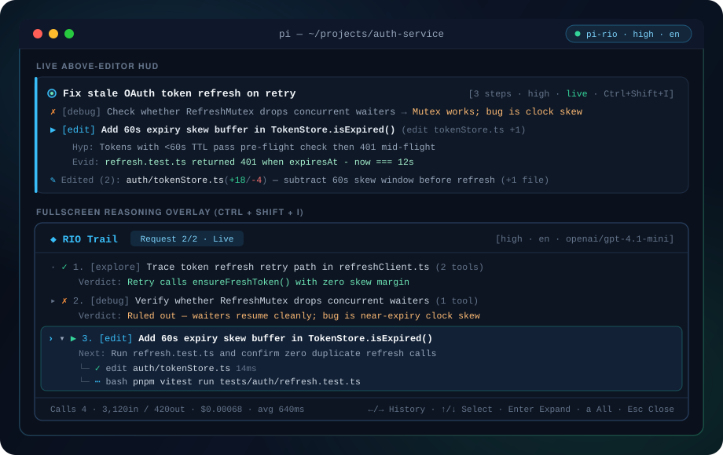

# pi-rio

**A cheap-model Radar Intercept Officer (RIO) for Pi.**
Turns raw agent thinking and tool spam into a live, human-readable reasoning trail.

[](https://www.npmjs.com/package/pi-rio)


[Preview](#preview) · [Why](#why-pi-rio) · [Quick Start](#quick-start) · [Granularity](#granularity-levels) · [Commands](#commands--keybindings) · [Architecture](#architecture) · [Configuration](#configuration)

---

## Preview



> In a fighter jet, the **RIO** (*Radar Intercept Officer*) sits in the backseat watching the radar scope—tracking targets, calling out turns, and warning the pilot before they fly into a wall.
>
> **`pi-rio`** puts a cheap sidecar model in the backseat of your coding agent. While your flagship model codes, `pi-rio` watches every turn in the background and surfaces **why** each step is happening, **what** hypothesis is being tested, **when** the agent pivots, and **why** each file was changed.

---

## Why `pi-rio`?

Watching a coding agent execute twenty `read` / `grep` / `bash` calls tells you *what* tools ran, not *what the agent actually thinks*.

| Without `pi-rio` | With `pi-rio` |
|---|---|
| `read refreshClient.ts` → `read tokenStore.ts` → `bash vitest` → `edit tokenStore.ts` | `✓ [explore]` Found retry path → `✗ [debug]` Mutex ruled out (clock skew) → `▶ [edit]` Add 60s expiry skew buffer |
| Rejected dead ends vanish into raw scrollback | Disproven hypotheses are marked `✗` with an explicit verdict |
| Edited files show raw diffs without intent | Every touched file tracks `(+added/-removed)` plus a one-line **why** |
| Hard to spot an agent stuck in a retry loop | Detects repeated errors/searches and raises a `⚠` alert |

### Highlights

- **Zero latency tax** — Fire-and-forget async sidecar. Never awaits inside `message_end` or slows down tool execution.
- **3 dedicated granularity prompts** — Switch live between `low`, `medium`, and `high`, each with its own system prompt, token budget, and HUD density.
- **Any cheap model, out of the box** — Works immediately in `auto` mode by selecting the fastest cheap model in your Pi registry, or pin a default with `/rio model`.
- **Multilingual output** — Switch sidecar output to any language (`/rio lang en|zh|ja|ko|es|auto`), with localized TUI chrome for English and Chinese.
- **Session-tree aware** — Persists snapshots into Pi's session branch so `/tree` switches restore the exact trail for that branch.
- **Live JSON feed** — Atomically publishes per-session state to `~/.pi/agent/rio-live/` for external HUDs, status bars, or dashboards.

---

## Quick Start

Install via Pi's package manager:

```bash
pi install npm:pi-rio
```

Try it for a single session without editing your settings:

```bash
pi -e npm:pi-rio
```

Or load directly from a local checkout while developing:

```bash
pi --extension /path/to/pi-rio/src/index.ts
```

> **Tip:** `pi-rio` works out of the box in `auto` model mode (`en` output, `medium` detail). Pin your preferred cheap model or tune granularity anytime:
>
> ```text
> /rio model openai/gpt-4.1-mini
> /rio lang en
> /rio detail high
> ```

---

## Granularity Levels

Every detail tier swaps in a **dedicated system prompt** (`src/prompts.ts`), adjusts context and token budgets, and adapts both the inline HUD and fullscreen overlay:

| Level | Best for | Sidecar prompt & fields | Token budget | Inline HUD |
|---|---|---|---|---|
| **`low`** | Glanceable status, lowest cost | Aggressive `keep`, short milestone phrases; omits `hypothesis`, `evidence`, `nextPlan` | 350/350 thinking chars · `maxTokens: 768` | Header + active milestone + compact file count |
| **`medium`** *(default)* | Daily coding workflows | Balanced steps with `hypothesis`, `prevVerdict`, `pivot`, per-file `why`, and loop `warning` | 650/650 thinking chars · `maxTokens: 1536` | Header + previous step + active step & hypothesis + latest edited file |
| **`high`** | Deep debugging & audits | Splits sub-investigations, names concrete symbols/errors, populates **`evidence`** and **`nextPlan`** | 1400/1400 thinking chars · `maxTokens: 2560` | Header + 2 recent steps + active step + dedicated `Hyp` / `Evid` / `Next` lines + 2 latest files |

Switch live mid-session with `/rio detail low`, `/rio detail medium`, or `/rio detail high`.

---

## Commands & Keybindings

### Slash commands

| Command | Aliases | Description |
|---|---|---|
| `/rio` | — | Open the interactive reasoning trail overlay |
| `/rio model [provider/id \| auto]` | — | Show or switch the default sidecar model (tab-completes `auto` and available models) |
| `/rio lang [en \| zh \| auto \| code]` | `/rio language` | Show or switch output language (`auto` reads `LC_ALL` / `LANG`, falling back to `en`) |
| `/rio detail [low \| medium \| high]` | `/rio level`, `/rio granularity` | Show or switch prompt & display granularity |
| `/rio toggle` | `/rio on`, `/rio off` | Pause or resume live tracking |
| `/rio status` | `/rio debug` | Show active config, resolved model, call count, tokens, cost, and average latency |
| `/rio clear` | — | Clear the current reasoning trail |

### Shortcuts & Overlay navigation

| Key | Action |
|---|---|
| `Ctrl+Shift+I` | Open the fullscreen reasoning trail overlay |
| `↑` / `↓` or `k` / `j` | Move between steps |
| `Enter` / `Space` | Expand or collapse tool calls for the selected step |
| `a` | Expand or collapse all steps |
| `←` / `→` or `h` / `l` or `[` / `]` | Browse archived trails from earlier requests in this session |
| `Esc` / `q` | Close overlay |

---

## Architecture

`pi-rio` splits observability into **two layers** so UI feedback is instantaneous while keeping sidecar cost minimal:

```text
Main Agent Turn
  ├── Layer 0 (Local hooks · 0ms · $0)
  │     ├── Instant placeholder step when tool calls begin
  │     ├── Live tool status (⋯ / ✓ / ✗), duration, and error snippets
  │     ├── File mutation tracking (+added / -removed lines, edit count)
  │     └── Cost guard (skips pure chitchat turns with no tools and no trace)
  │
  └── Layer 1 (Async Cheap-Model Sidecar)
        ├── Picks dedicated system prompt for low | medium | high + target language
        ├── Coalesces queued read-only turns; always preserves edit/write turns
        └── Emits a structured JSON IntentPatch:
              op:    keep | push | resolve_and_push | pivot | done
              phase: explore | plan | edit | verify | debug | done
              data:  intent, hypothesis, evidence, nextPlan, prevVerdict, fileChanges, warning
```

Because Layer 1 sends only a compact summary of recent steps plus the current turn's head/tail thinking slice, input context stays bounded even in 100-turn sessions.

---

## Configuration

Settings live at `~/.pi/agent/rio.json` and update automatically when you run `/rio` commands:

```json
{
  "enabled": true,
  "provider": "",
  "modelId": "auto",
  "language": "en",
  "detail": "medium",
  "showWidgetWhenIdle": true
}
```

| Field | Type | Default | Description |
|---|---|---|---|
| `enabled` | `boolean` | `true` | Enable or pause sidecar tracking |
| `provider` | `string` | `""` | Provider name from your Pi model registry (empty when `modelId` is `"auto"`) |
| `modelId` | `string` | `"auto"` | Sidecar model ID, or `"auto"` to auto-pick the cheapest fast available model |
| `language` | `string` | `"en"` | `"en"`, `"zh"`, `"auto"`, or any language code/name (`"ja"`, `"ko"`, `"es"`, `"fr"`, `"de"`, ...) |
| `detail` | `"low" \| "medium" \| "high"` | `"medium"` | Granularity level for system prompts, token budgets, and TUI density |
| `showWidgetWhenIdle` | `boolean` | `true` | Keep the final summary visible above the editor after a run settles |

---

## Live JSON Feed

For external status bars, web viewers, or multi-agent dashboards, `pi-rio` atomically publishes each active session to:

```text
~/.pi/agent/rio-live/<sessionId>.json
```

- Written via temp-file + atomic `rename` with `version`, `sessionId`, `cwd`, `projectName`, `pid`, `detail`, `language`, `alive`, `updatedAt`, `stats`, and the full `state` tree.
- Stale dead session files older than 24 hours are pruned automatically on startup.

---

## Development

```bash
npm install
npm test
npm run typecheck
```

---

MIT License · Built for [Pi](https://pi.dev)
